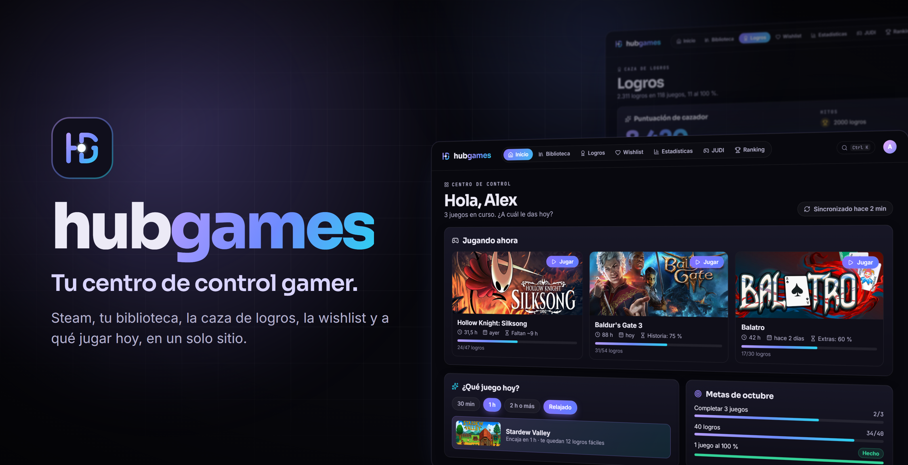
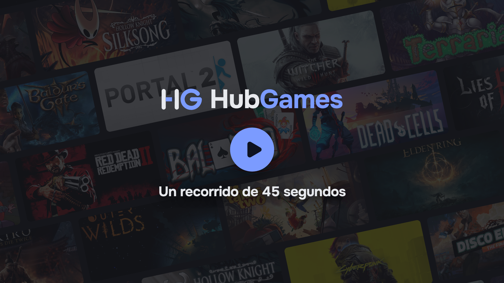
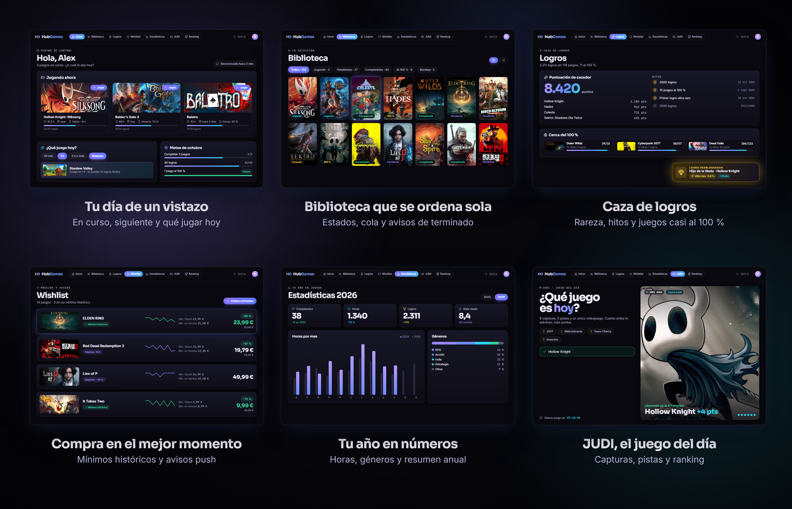

<div align="center">
  <a href="https://hub-games.vercel.app"></a>
  <p>
    <a href="https://hub-games.vercel.app"><strong>Abrir HubGames →</strong></a>
    &nbsp;·&nbsp;
    <a href="docs/readme/hubgames-promo.mp4"><strong>▶ Ver el vídeo</strong></a>
  </p>
  <p>
    
    
    
    
    <a href="https://github.com/Diego-Mardomingo/HubGames/actions/workflows/ci.yml"></a>
  </p>
</div>

---

## Por qué HubGames

Tienes cientos de juegos en Steam, una lista de pendientes que solo crece y logros a medias repartidos por todas partes. HubGames lo junta todo: **vinculas tu cuenta de Steam y todo lo que se puede saber, lo sabe solo.** Biblioteca, horas, logros, cuánto dura cada juego y cuánto cuesta lo que tienes en la wishlist.

Tú solo decides a qué jugar. Y si no lo tienes claro, también te ayuda con eso.

<div align="center">
  <a href="docs/readme/hubgames-promo.mp4"></a>
  <br>
  <sub>50 segundos de recorrido. Clic para reproducirlo.</sub>
</div>

## Qué puedes hacer



### 🔗 Vincular Steam y olvidarte
Un clic y listo. Cada noche se sincronizan tu biblioteca, tus horas, tus logros y tu wishlist. ¿Acabas de jugar? Tienes un botón de **Sincronizar ahora**. Como Steam solo da las horas totales, HubGames guarda una foto diaria y te dice cuánto jugaste cada día y a qué.

### 🏠 Saber a qué jugar hoy
Al entrar ves lo que tienes en curso, lo siguiente en la cola y los juegos a punto del 100 %. **¿Qué juego hoy?** te propone algo según el tiempo que tienes y lo que te apetece. Y las **metas del mes** se miden solas.

### 📚 Una biblioteca que se ordena sola
Bandeja, pendiente, jugando, pausado, completado, abandonado… Los estados cambian solos cuando empiezas un juego, y si parece que lo has terminado, HubGames te pregunta **«¿Lo has terminado?»**. Ordena tus pendientes arrastrando y pon un límite de juegos a la vez para no abrir veinte frentes.

### 🃏 Todo sobre cada juego
Ficha con tráiler y capturas, cuánto dura según **HowLongToBeat**, tus horas, tus logros, tu nota y tu reseña. Ponle un **objetivo** (historia, extras o 100 %) y mira cuánto te falta. Busca cualquier juego de Steam con <kbd>Ctrl</kbd> + <kbd>K</kbd>.

### 🏆 Cazar logros con cabeza
Cada logro puntúa según su rareza, así que un 1 % vale mucho más que un 50 %. Encuentra los **logros fáciles que te faltan**, los juegos **casi al 100 %** y los que tienes olvidados. Y presume de hitos, línea temporal, heatmap anual y rachas.

### 💸 Comprar en el mejor momento
Tu wishlist con el precio actual, el **mínimo histórico en Steam y en cualquier tienda** (IsThereAnyDeal). Ponle un precio o un descuento objetivo y recibe un **aviso push** cuando llegue.

### 📊 Ver tu año en números
Completados, horas, notas, géneros y logros por mes, comparados con el año anterior. A final de año, un **resumen anual** estilo Wrapped con imagen para compartir. Y tus datos son tuyos: expórtalos a CSV o JSON cuando quieras.

### 🎯 Y cada día, un reto: JUDI
Un videojuego al día, 6 capturas y 5 pistas. Cuanto antes lo adivinas, más puntos sumas en el **ranking**. Se puede jugar sin cuenta, y el nombre del juego no llega a tu navegador hasta que terminas: nada de trampas.

## Llévala en el móvil

HubGames es una PWA: ábrela en el navegador y elige **«Instalar»** (escritorio y Android) o **«Añadir a pantalla de inicio»** (iOS). Tiene barra de pestañas abajo, se abre como una app y te manda avisos push de precios y del JUDI del día. En iPhone, los avisos solo funcionan con la app instalada.

## De dónde salen los datos

| Fuente | Qué aporta |
|:---|:---|
| [Steam Web API](https://steamcommunity.com/dev) | Biblioteca, horas, logros, rareza global y wishlist |
| [Steam Store](https://store.steampowered.com/) | Fichas, precios, capturas y tráileres |
| [SteamSpy](https://steamspy.com/) | Popularidad, reseñas y duración de respaldo |
| [HowLongToBeat](https://howlongtobeat.com/) | Duración de historia, extras y 100 % |
| [IsThereAnyDeal](https://isthereanydeal.com/) | Mínimos históricos en Steam y en cualquier tienda |

## Hecho con

Next.js · React · TypeScript · Tailwind CSS · Framer Motion · Supabase · Vercel · GitHub Actions

Todo funciona con planes gratuitos: Vercel Hobby, Supabase Free y GitHub Actions.

Diseño: superficies planas, un único acento cobalto y color solo para la rareza de los logros, en tema claro y oscuro. Tokens, componentes y reglas en la [guía de estilo](docs/design-system.md).

<details>
<summary><strong>🛠️ Para desarrolladores</strong></summary>

### Puesta en marcha

Requisitos: **Node 22** y un proyecto de Supabase con las migraciones aplicadas.

```bash
npm ci
# crea .env.local (ver abajo)
npm run dev          # http://localhost:3000
```

| Variable | Para qué |
|:---|:---|
| `NEXT_PUBLIC_SUPABASE_URL`, `NEXT_PUBLIC_SUPABASE_ANON_KEY` | Cliente de Supabase |
| `SUPABASE_SERVICE_ROLE_KEY` | Route handlers y scripts del servidor (nunca en el cliente) |
| `NEXT_PUBLIC_SITE_URL` | URL pública (metadatos y vuelta de Steam OpenID) |
| `STEAM_WEB_API_KEY` | Steam Web API ([consíguela aquí](https://steamcommunity.com/dev/apikey)) |
| `ITAD_API_KEY` | Precios y mínimos de [IsThereAnyDeal](https://isthereanydeal.com/apps/my/) |
| `NEXT_PUBLIC_WEB_PUSH_VAPID_PUBLIC_KEY` | Suscripción a notificaciones en el navegador |
| `WEB_PUSH_VAPID_PUBLIC_KEY`, `WEB_PUSH_VAPID_PRIVATE_KEY` | Envío de avisos push (mismo par de claves) |
| `NEXT_PUBLIC_JUDI_MAINTENANCE` | Opcional: `true` pone JUDI en mantenimiento |

### Comandos

| Comando | Qué hace |
|:---|:---|
| `npm run dev` / `npm run build` / `npm start` | Desarrollo, build y servidor de producción |
| `npm run lint` / `npm run typecheck` / `npm test` | ESLint, `tsc` y los tests de `src/lib` (`node:test`) |
| `npm run db:types` | Regenera `src/lib/supabase/database.types.ts` |
| `npm run steam:sync` | Sincronización con Steam de todos los usuarios vinculados |
| `npm run judi:pick-daily` / `npm run judi:build-pool` | Elegir el JUDI de mañana / rehacer el pool semanal |

### Estructura

```
HubGames/
├── src/
│   ├── app/                 # App Router: páginas y route handlers
│   ├── components/          # Nav, dashboard, tracker, achievements, wishlist, marca y ui (shadcn)
│   ├── lib/                 # Lógica pura con tests (*.test.ts) y acceso a datos (*-db.ts)
│   ├── styles/              # Tokens y estilos globales, navegación, listas y piezas ui (ver docs/design-system.md)
│   └── proxy.ts             # Sesión y protección de /admin
├── scripts/                 # Tareas de los workflows (sync, JUDI, health check, avisos de precio, HLTB)
├── supabase/                # Migraciones de HubGames y Edge Function del aviso de JUDI
├── worker/                  # Service Worker (notificaciones push)
├── promo/                   # Vídeo e imágenes del README (Remotion)
└── .github/workflows/       # CI y tareas programadas
```

### Automatizaciones

| Workflow | Cuándo (UTC) | Qué hace |
|:---|:---|:---|
| `CI` | En cada PR y push a `master` | `lint`, `typecheck`, `test` y `build` |
| `Steam Sync` | Cada día, 01:00 | Biblioteca, foto de horas, wishlist, precios y logros; después, los avisos de precio |
| `JUDI Daily Pick` | Cada día, 10:00 | Elige el JUDI del día siguiente |
| `JUDI Pool Weekly` | Domingos, 18:00 | Rehace el pool de juegos candidatos |
| `HLTB Weekly` | Lunes, 04:00 | Duraciones de HowLongToBeat (Python, `howlongtobeatpy`) |
| `Health Check` | Cada día, 19:00 | Comprueba que existe el JUDI de mañana y que la sincronización va al día |

Si un workflow programado falla, se abre (o se comenta) un issue que se cierra solo cuando vuelve a ir bien. En Supabase, un job de `pg_cron` llama a las 16:00 UTC a la Edge Function `send_daily_judi_notifications` (protegida con `x-cron-secret` guardado en Vault). `master` está protegida: solo se cambia con PR y el CI en verde.

### Base de datos

La base de datos de Supabase está **compartida con ECOS** (tablas y funciones `ecos_*`). Aquí solo se versionan los objetos `hubgames_*`; **nunca tocar `ecos_*`**.

- `supabase/migrations/20261024000000_hubgames_baseline.sql` es el estado base. Los cambios van en migraciones `AAAAMMDDHHMMSS_descripcion.sql` posteriores.
- Para aplicarlas: SQL Editor de Supabase, o `npx supabase db push` tras `npx supabase link --project-ref <ref>`.
- Si cambia el esquema, `npm run db:types` y revisa el diff.
- Todas las tablas `hubgames_*` tienen RLS. JUDI solo se lee con funciones `security definer` (`hubgames_judi_*`) y `/admin` se protege en el servidor con `src/proxy.ts` e `is_admin()`.

### Vídeo e imágenes del README

Están hechos con [Remotion](https://www.remotion.dev/) en `promo/`, con datos inventados y carátulas públicas de Steam. La música se sintetiza con `promo/scripts/music.mjs` y los efectos de sonido son de [Kenney](https://kenney.nl/) (CC0).

```bash
cd promo && npm ci
npm run studio    # vista previa editable
npm run render    # docs/readme/hubgames-promo.mp4
npm run stills    # hero.png, screens.png y video.png
```

</details>

---

<div align="center">
  <sub>Hecho por <a href="https://github.com/Diego-Mardomingo">Diego Mardomingo</a>. Los nombres e imágenes de los juegos pertenecen a sus dueños; los datos de las capturas son de ejemplo.</sub>
</div>
