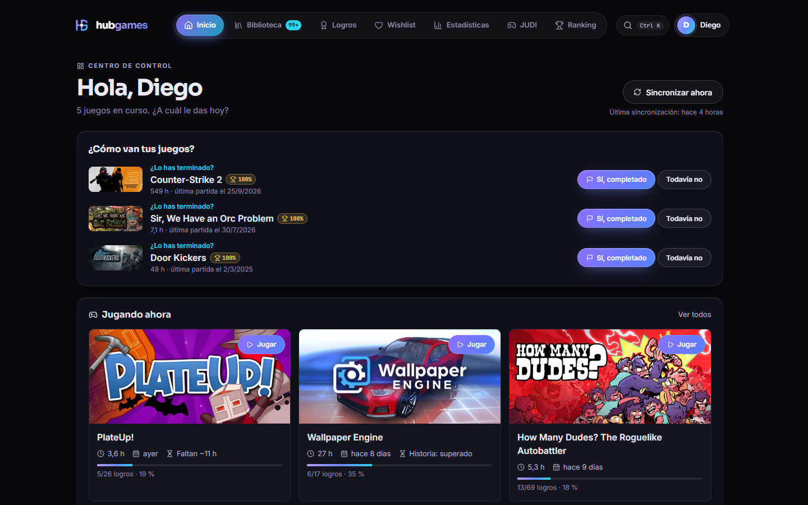
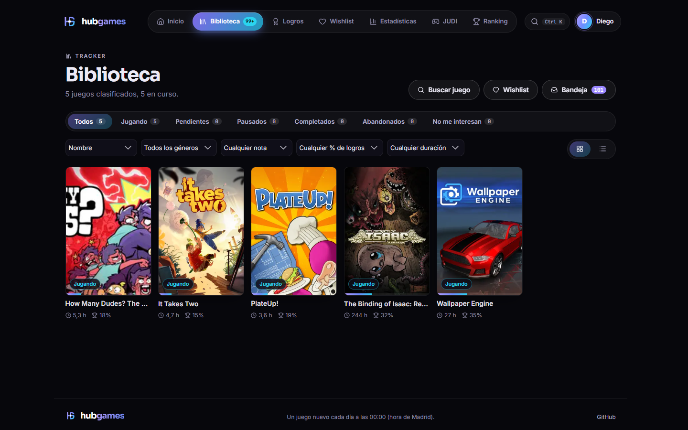
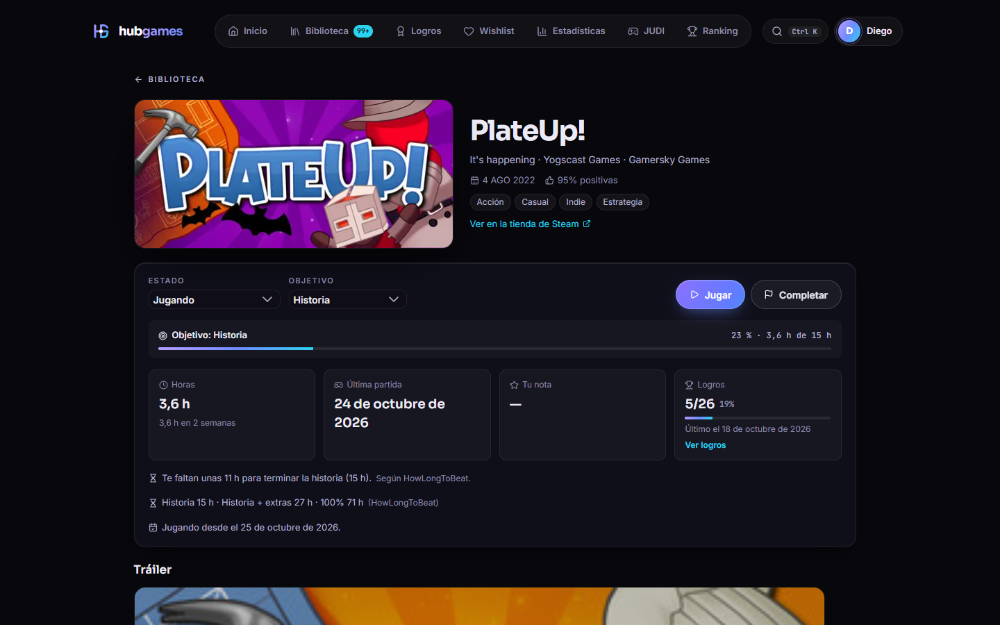
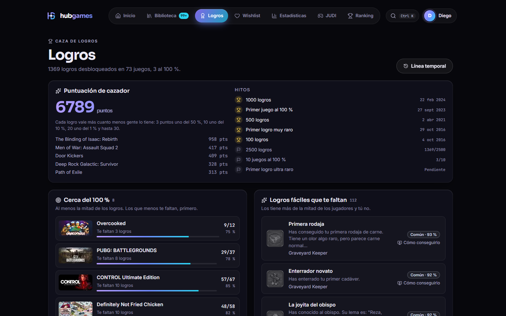
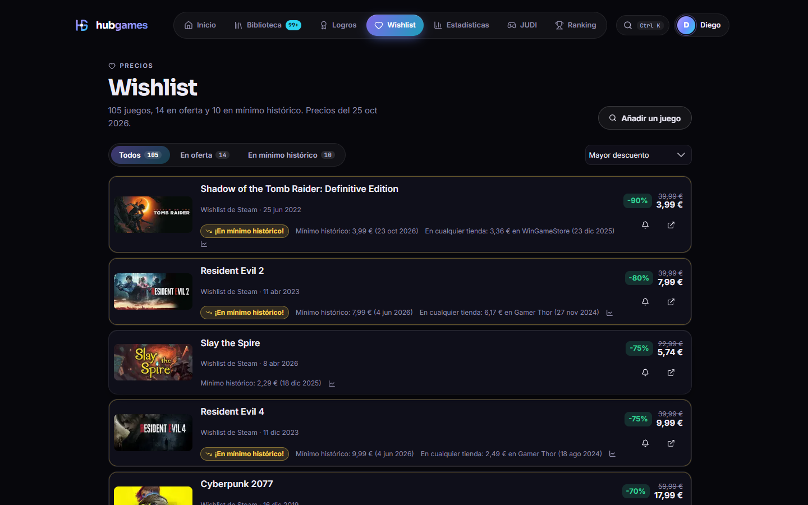
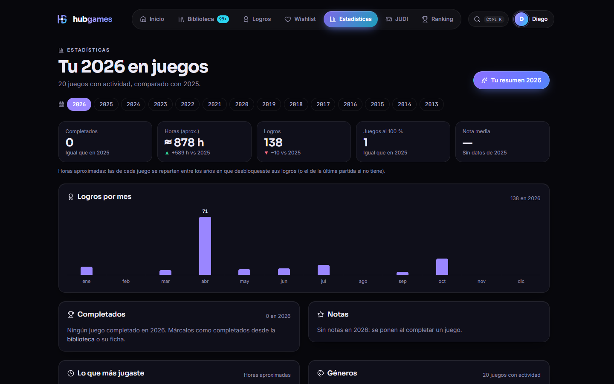
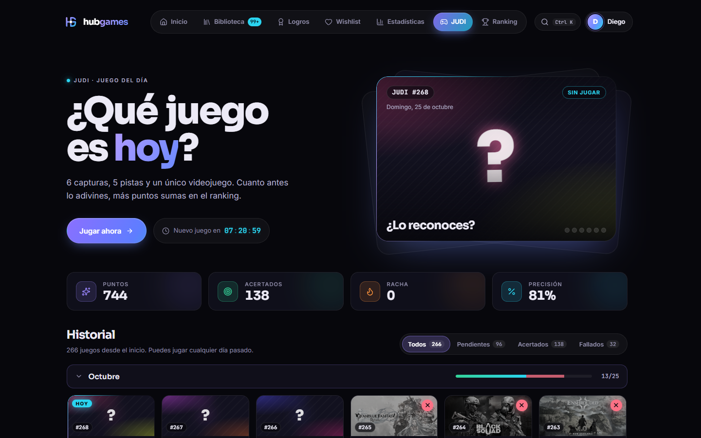

<div align="center">


# 🎮 HubGames

### *Tu centro de control gamer*

**Steam, tu biblioteca, la caza de logros y a qué jugar hoy, en un solo sitio.**

[](https://hub-games.vercel.app/)

[](https://nextjs.org/)
[](https://www.typescriptlang.org/)
[](https://supabase.com/)
[](https://steamcommunity.com/dev)
[](https://web.dev/progressive-web-apps/)
[](https://github.com/Diego-Mardomingo/HubGames/actions/workflows/ci.yml)

<a href="#-qué-es">Qué es</a> •
<a href="#-características">Características</a> •
<a href="#-capturas">Capturas</a> •
<a href="#-puesta-en-marcha">Puesta en marcha</a> •
<a href="#-automatizaciones">Automatizaciones</a> •
<a href="#️-base-de-datos-y-migraciones">Base de datos</a>

</div>

---

## 🧭 Qué es

HubGames es un **tracker personal de juegos centrado en Steam y en la caza de logros**. Vinculas tu cuenta de Steam y todo lo que se puede obtener solo se obtiene solo: biblioteca, horas, logros, duraciones de HowLongToBeat y precios de tu wishlist. Tú solo pones la nota, confirmas cuándo has terminado un juego y, si quieres, ordenas tus pendientes.

Al entrar ves qué tienes en curso, qué tienes en la cola, qué logros te faltan y qué te conviene jugar hoy. **JUDI**, el minijuego diario de adivinar el videojuego, sigue como sección secundaria con su ranking.

Funciona con planes gratuitos: Vercel Hobby, Supabase Free y GitHub Actions.

## ✨ Características

| | Qué hace |
|:---:|:---|
| 🔗 **Steam** | Vinculas tu cuenta desde `/perfil` (OpenID). Cada noche se sincronizan tu biblioteca, horas, logros y wishlist; también hay un botón **Sincronizar ahora**. |
| ⏱️ **Historial de horas** | Steam solo da las horas totales, así que cada día se guarda una foto y se calculan las horas por día y por juego. |
| 📚 **Biblioteca** | Estados (bandeja, pendiente, jugando, pausado, completado, abandonado, descartado), con cambios automáticos y sugerencias ("¿Lo has terminado?"). Vista en cuadrícula o lista, filtros, orden de pendientes arrastrando y límite de juegos en curso. |
| 🃏 **Ficha del juego** | `/juego/[appid]`: datos de Steam, tráiler y capturas, duración de HowLongToBeat, tus horas y logros, nota y reseña, y un **objetivo** (historia, extras o 100 %) con su progreso. Buscador de Steam con `Ctrl+K`. |
| 🏆 **Logros** | Página de logros por juego con rareza y dificultad estimada. Vistas de cazador: cerca del 100 %, logros fáciles que te faltan, juegos olvidados y tus logros más raros. Puntuación ponderada por rareza, hitos, línea temporal, heatmap anual y rachas. |
| 🏠 **Dashboard** | Jugando ahora, siguientes en la cola, cerca del 100 %, actividad reciente, JUDI de hoy, **¿Qué juego hoy?** (según el tiempo que tienes y lo que te apetece) y **metas mensuales** que se miden solas. |
| 📊 **Estadísticas** | `/estadisticas?year=AAAA`: completados, horas, notas, géneros, logros por mes, juegos al 100 % y comparación con el año anterior. **Resumen anual** estilo Wrapped con imagen para compartir. Exportación de tus datos a CSV o JSON. |
| 💸 **Wishlist** | Tu wishlist de Steam con el precio actual, el mínimo histórico en Steam y en cualquier tienda (IsThereAnyDeal). **Avisos push** cuando un juego llega a su mínimo o a tu precio o descuento objetivo. |
| 🎯 **JUDI** | Un videojuego cada día: 6 capturas y 5 pistas. Cuanto antes lo adivinas, más puntos. Los intentos se comprueban en el servidor y el nombre no llega al navegador hasta terminar. Se puede jugar sin cuenta; con cuenta, tu partida cuenta para el ranking. |
| 📱 **PWA** | Instalable en móvil, con barra de pestañas inferior y notificaciones push. |

## 📸 Capturas

<div align="center">

**Dashboard**<br/>


**Biblioteca**<br/>


**Ficha del juego**<br/>


**Logros**<br/>


**Wishlist**<br/>


**Estadísticas**<br/>


**JUDI**<br/>


</div>

## 🗺️ Rutas

| Ruta | Qué es |
|:---|:---|
| `/` | Dashboard con sesión; portada sin ella |
| `/biblioteca`, `/biblioteca/bandeja` | Biblioteca y bandeja de juegos sin clasificar |
| `/juego/[appid]`, `/juego/[appid]/logros` | Ficha del juego y sus logros |
| `/logros`, `/logros/historial` | Caza de logros e historial (línea temporal, heatmap y rachas) |
| `/wishlist` | Wishlist con precios y avisos |
| `/estadisticas`, `/estadisticas/resumen` | Estadísticas por año y resumen anual |
| `/judi`, `/ranking` | JUDI y su ranking |
| `/perfil` | Cuenta, Steam, notificaciones y exportar datos |
| `/admin` | Panel de JUDI (solo administradores, protegido en el servidor) |
| `/api/steam/*` | Vincular, desvincular, sincronizar y buscar en Steam |
| `/api/wishlist`, `/api/export` | Añadir o quitar de la wishlist; descarga de tus datos |
| `/api/judi/captura/[id]/[fase]` | Capturas de JUDI sin exponer la URL de Steam |
| `/api/estadisticas/resumen/imagen` | Imagen del resumen anual (`next/og`) |

## 📂 Estructura

```
HubGames/
├── src/
│   ├── app/                 # App Router: páginas y route handlers (ver Rutas)
│   ├── components/          # Nav, dashboard, tracker, achievements, wishlist, ui (shadcn) y motion
│   ├── lib/                 # Lógica pura con tests (*.test.ts) y acceso a datos (*-db.ts)
│   │   ├── supabase/        # Clientes (navegador, servidor y admin) y tipos generados
│   │   ├── steam.ts         # Steam Web API, Store API y SteamSpy
│   │   ├── steam-sync.ts    # Sincronización completa de un usuario
│   │   └── …                # tracker, library, achievements, dashboard, stats, judi, prices…
│   ├── styles/              # Estilos globales y navegación
│   └── proxy.ts             # Sesión y protección de /admin
├── scripts/                 # Tareas de los workflows (sync, JUDI, health check, avisos de precio, HLTB en Python)
├── supabase/
│   ├── migrations/          # Migraciones de HubGames
│   └── functions/           # Edge Function del aviso diario de JUDI
├── worker/                  # Código extra del Service Worker (notificaciones push)
├── .github/workflows/       # CI y tareas programadas
└── legacy_php_code/         # Versión PHP original (histórico)
```

## 🚀 Puesta en marcha

Requisitos: **Node 22** y un proyecto de Supabase con las migraciones aplicadas.

```bash
npm ci
# crea .env.local (ver abajo)
npm run dev          # http://localhost:3000
```

**Variables de `.env.local`**

| Variable | Para qué |
|:---|:---|
| `NEXT_PUBLIC_SUPABASE_URL`, `NEXT_PUBLIC_SUPABASE_ANON_KEY` | Cliente de Supabase |
| `SUPABASE_SERVICE_ROLE_KEY` | Route handlers y scripts del servidor (nunca en el cliente) |
| `NEXT_PUBLIC_SITE_URL` | URL pública (metadatos y vuelta de Steam OpenID) |
| `STEAM_WEB_API_KEY` | Steam Web API ([consíguela aquí](https://steamcommunity.com/dev/apikey)) |
| `ITAD_API_KEY` | Precios y mínimos de [IsThereAnyDeal](https://isthereanydeal.com/apps/my/) |
| `NEXT_PUBLIC_WEB_PUSH_VAPID_PUBLIC_KEY` | Suscripción a notificaciones en el navegador |
| `WEB_PUSH_VAPID_PUBLIC_KEY`, `WEB_PUSH_VAPID_PRIVATE_KEY` | Envío de avisos push (mismo par de claves) |
| `NEXT_PUBLIC_JUDI_MAINTENANCE` | Opcional: `true` pone JUDI en mantenimiento |

**Comandos**

| Comando | Qué hace |
|:---|:---|
| `npm run dev` / `npm run build` / `npm start` | Desarrollo, build y servidor de producción |
| `npm run lint` / `npm run typecheck` / `npm test` | ESLint, `tsc` y los tests de `src/lib` (`node:test`) |
| `npm run db:types` | Regenera `src/lib/supabase/database.types.ts` |
| `npm run steam:sync` | Sincronización con Steam de todos los usuarios vinculados |
| `npm run judi:pick-daily` / `npm run judi:build-pool` | Elegir el JUDI de mañana / rehacer el pool semanal |

## ⚙️ Automatizaciones

**GitHub Actions**

| Workflow | Cuándo (UTC) | Qué hace |
|:---|:---|:---|
| `CI` | En cada PR y push a `master` | `lint`, `typecheck`, `test` y `build` |
| `Steam Sync` | Cada día, 01:00 | Biblioteca, foto de horas, wishlist, precios y logros; después, los avisos push de precio |
| `JUDI Daily Pick` | Cada día, 10:00 | Elige el JUDI del día siguiente |
| `JUDI Pool Weekly` | Domingos, 18:00 | Rehace el pool de juegos candidatos |
| `HLTB Weekly` | Lunes, 04:00 | Duraciones de HowLongToBeat (Python, `howlongtobeatpy`) |
| `Health Check` | Cada día, 19:00 | Comprueba que existe el JUDI de mañana y que la sincronización va al día |

Si un workflow programado falla, se abre (o se comenta) un issue automáticamente, que se cierra solo cuando vuelve a ir bien.

**Supabase**: un job de `pg_cron` llama a las 16:00 UTC a la Edge Function `send_daily_judi_notifications`, que envía el aviso de "nuevo JUDI". La función exige una cabecera `x-cron-secret`; el secreto está en Vault y el job lo lee de ahí.

**Rama `master`**: protegida. Solo se cambia con PR y con el check `check` del CI en verde.

## 🧩 Fuentes de datos

| Fuente | Qué aporta |
|:---|:---|
| [Steam Web API](https://steamcommunity.com/dev) | Biblioteca, horas, logros, porcentajes globales y wishlist |
| [Steam Store API](https://store.steampowered.com/api/appdetails) | Fichas, precios, capturas y tráileres |
| [SteamSpy](https://steamspy.com/api.php) | Popularidad, reseñas y duración mediana (respaldo de HowLongToBeat) |
| [HowLongToBeat](https://howlongtobeat.com/) | Duración de historia, extras y 100 % (scraping semanal con `howlongtobeatpy`) |
| [IsThereAnyDeal](https://isthereanydeal.com/) | Mínimo histórico en Steam y en cualquier tienda |

## 🗄️ Base de datos y migraciones

La base de datos de Supabase está **compartida con ECOS**, otra app (tablas y funciones `ecos_*`). En este repo solo se versionan los objetos de HubGames (`hubgames_*`, sus políticas RLS, triggers, funciones propias y el cron de JUDI). **Nunca tocar `ecos_*`.**

- `supabase/migrations/20261024000000_hubgames_baseline.sql` es el estado base del esquema. Los cambios van en migraciones `AAAAMMDDHHMMSS_descripcion.sql` posteriores, que solo tocan objetos `hubgames_*`.
- Para aplicarlas: SQL Editor de Supabase, o `npx supabase db push` tras `npx supabase login` y `npx supabase link --project-ref <ref>`.
- Si cambia el esquema, regenera los tipos con `npm run db:types` y revisa el diff. Las funciones RPC que se tipan se declaran en `scripts/gen-db-types.mjs`.

**Seguridad**

- Todas las tablas `hubgames_*` tienen RLS: cada usuario ve y cambia solo lo suyo.
- El perfil lo crea el trigger `on_hubgames_auth_user_created` sobre `auth.users`. La clave anon no puede leer `hubgames_usuarios`.
- JUDI: la lista, las capturas y las respuestas solo se leen con funciones `security definer` (`hubgames_judi_*`), y el progreso solo lo escriben ellas.
- `/admin` se protege en el servidor con `src/proxy.ts` y `is_admin()`.

## 👨‍💻 Autor

<div align="center">

**Diego López Mardomingo**

[](https://github.com/Diego-Mardomingo)

<sub>Proyecto personal. Los datos de videojuegos vienen de Steam, SteamSpy, HowLongToBeat e IsThereAnyDeal.</sub>

</div>
